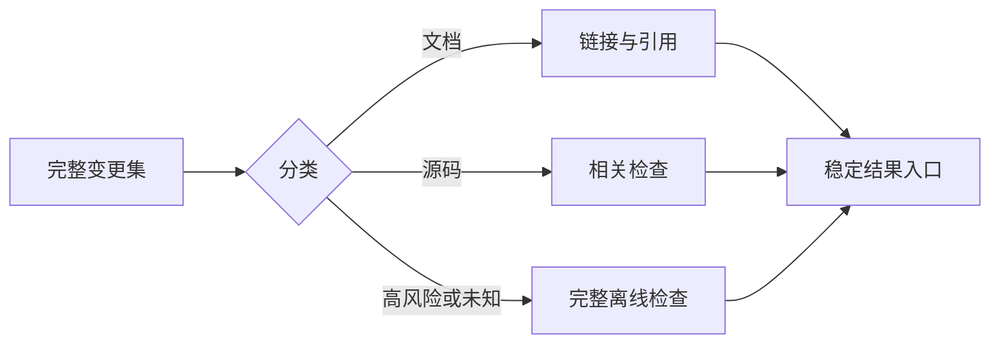

# Yeisme Skills CI/CD

<a id="分级"></a>
<a id="quick"></a>
<a id="full"></a>
<a id="integration"></a>
<a id="release"></a>
<a id="模块和兼容"></a>
<a id="本地检查"></a>

## 发布兼容

本项目不发布二进制；Skills 发布遵循源仓库的现有流程。

手动触发只允许验证、integration 或 snapshot。正式发布必须来自项目约定的 SemVer tag，发布前执行必需检查；只有同一修订、可信来源和摘要一致的证据才可复用，否则重新验证。

<!-- change-aware-ci:start -->
## 当前按改动分流

文档 PR 和纯文档主干更新只检查相关链接；普通源码 PR 检查受影响组件；依赖、脚本、权限、合同、迁移、集成测试与未知路径升级完整检查。主干源码更新执行完整离线检查。比较基线不可用时执行 full，不把空结果当成无需验证。



只执行选中的 lane。选中检查失败、取消或意外跳过均不能通过；未选中检查明确记录为跳过。原检查名称保留为兼容入口，远端分支保护需要按当前仓库单独核验。

本地入口：

```bash
python3 scripts/ci/changed_scope.py select
```

select 只报告级别，不执行检查。Go 快检沿包依赖与测试依赖扩展调用方，默认复用缓存；多模块项目按模块执行。没有 PR 环境时不会猜测比较范围。前端继续使用本项目已有测试器，不新增并行测试框架。

文档、Skills 或局部源码改动不要求重复全仓验证。覆盖率、耗时和文件行数用于诊断；关键行为、兼容与权限测试继续阻塞。默认入口不执行 race，也不调用真实 Provider、读取生产凭据或运行部署。

发布继续使用项目已有 owner 合同：同一修订的可信制品和检查可以复用，不可核验时重新执行一次；漏洞信息按发布时效核验。CI 缓存不是发布授权。配置、远端 CI、发布和部署结果分别报告，未运行不得写成通过。
<!-- change-aware-ci:end -->
